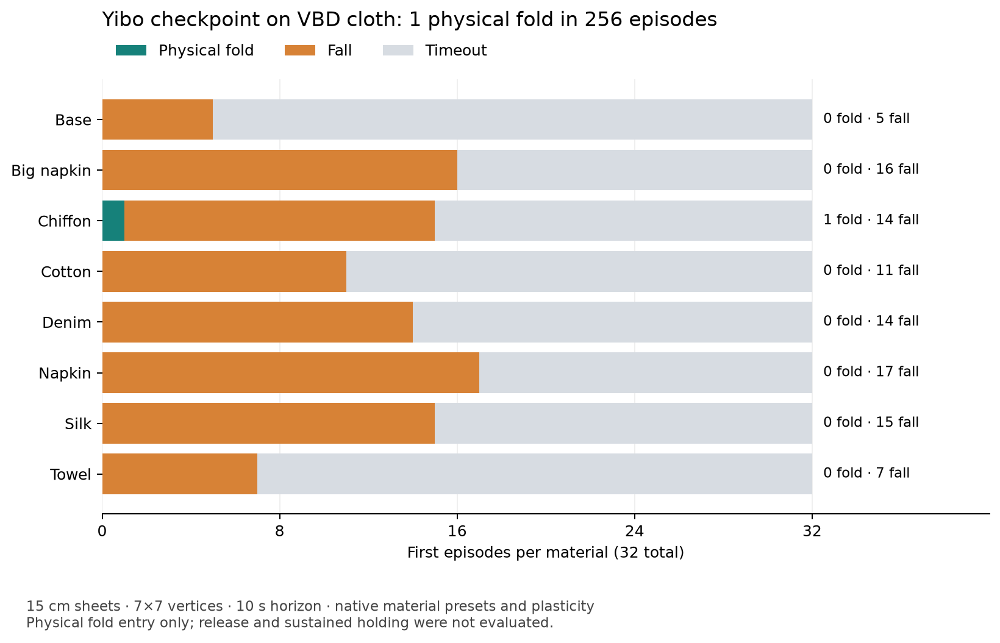

# Yibo checkpoint on VBD fabric presets

**All eight evaluations completed: one physical fold in 256 episodes.** Chiffon folded once in 32 trials; the other seven presets had zero folds. There were 99 fall terminations and 156 timeouts. These are fold-entry outcomes, not release or sustained-hold success.

| Material | Nominal mass (g) | Folds / 32 | Falls | Centroid left table | Median best fold error (cm) | Median post-settle peak flap height (cm) |
|---|---:|---:|---:|---:|---:|---:|
| Base | 45.00 | 0 | 5 | 5 | 14.94 | 0.99 |
| Big napkin | 1.80 | 0 | 16 | 17 | 14.91 | 1.05 |
| Chiffon | 0.40 | 1 | 14 | 14 | 14.71 | 1.80 |
| Cotton | 2.60 | 0 | 11 | 12 | 14.97 | 1.07 |
| Denim | 4.10 | 0 | 14 | 15 | 14.89 | 1.32 |
| Napkin | 0.90 | 0 | 17 | 19 | 14.90 | 0.99 |
| Silk | 2.60 | 0 | 15 | 19 | 14.90 | 1.15 |
| Towel | 7.30 | 0 | 7 | 8 | 14.94 | 1.52 |

## What failed

Most episodes remained nearly flat or poorly aligned: their best physical fold error stayed near the 15 cm sheet length. After the first second, the median per-episode peak height of a moving-half particle was only 0.99–1.80 cm above the table. Some episodes lifted a flap more substantially: the 95th percentile of this peak ranged from 2.7 to 10.1 cm across presets. Whole-sheet centroid height is not a valid flap-lift test; a correct fold can stay below the initial drop height.

Escapes were common, especially for light fabrics: the cloth centroid left the table in 19/32 napkin and silk episodes, compared with 5/32 for the much heavier base preset. This establishes a transport/escape failure pattern. It does not establish whether a grasp occurred; this evaluation has no grasp sensor.

All states, actions and rewards remained finite, and no accepted run overflowed a native contact/constraint buffer. Sampled post-settle worst edge stretch ranged from 1.19× to 1.56×, so local deformation can still be considerable. Sampled median peak actor marker-fit error ranged from 1.1 to 6.5 mm, with occasional outliers up to 61.8 mm. The rigid pose reconstructed by the historical actor cannot represent every deformation, but these measurements alone do not identify that mismatch as the cause.

The sweep does not isolate cloth material as the only transfer gap. Newton/MuJoCo-Warp drives the VBD robot and contacts; the original policy used PhysX. Matching the URDF, controller parameters and observation encoding does not make these solvers dynamically identical. The presets also change density, stretching, bending, damping, friction and plasticity together. One fold in 32 trials is too little evidence to rank chiffon as a robustly better material.

## Actuation sanity check

A separate 8-environment, 120-step / 2-second base-material run (`709920`) confirms that the policy is issuing actions and the VBD robot moves. Across environments, median peak arm-joint displacement was **0.282 rad (16.2°)**, median peak hand-joint displacement **1.623 rad (93.0°)**, and median peak palm displacement **16.0 cm**. Every environment reached an action magnitude of 1.0. Median arm target-tracking RMSE over the rollout was **0.0169 rad (0.97°)**, with environment values from 0.0102 to 0.0364 rad. The median per-environment peak instantaneous tracking RMSE was 0.0289 rad, with a worst peak of 0.0897 rad. All diagnostics were finite and no buffers overflowed.

This rules out globally zero actions or a globally frozen actuator pipeline. It does not establish PhysX/Newton dynamic parity, correct contact forces, successful grasping, or tracking quality throughout the full 10-second episodes. The short run is separate from the 256-episode material statistics above.

## Protocol and checks

- Original `pretrained_policy/flexiv_wuji_finetuned/flat7RW_fricition.pth`, historical Yibo actor encoding, deterministic actions, exploration coefficient zero, Yibo robot specification and real-limit URDF.
- Eight presets: base plus all seven measured materials. Each used a 15×15 cm sheet, 7×7 vertices and the native 16 mm contact thickness. All measured presets had their specified plasticity active; base had none.
- 32 first episodes per material, seed zero, 600 policy steps / 10 seconds, 120 Hz physics and 60 Hz actions. Observation/action noise was disabled. Resets varied joint state, cloth XY and yaw. The tabletop was 33 cm above the robot base, and the sheet started 5 cm above the table.
- Physical fold criteria were unchanged: maximum corner error below 4 cm and normalized footprint below 0.65. A synthetic perfect fold passed the scoring control and an initial flat sheet failed. Whole-robot release clearance is unsupported for VBD, so release was disabled and never counted.
- Post-settle statistics use stored diagnostic samples every 20 steps after step 60, while each first episode was active. Sampled maxima can miss between-sample peaks. Raw JSON also contains maxima accumulated every step over the entire rollout.
- An earlier attempt failed at the default 8192 global constraint capacity and was excluded. Accepted array `709496` used `njmax=32768`, `nconmax=8192`; these size buffers without changing constitutive/contact parameters. All 256 accepted episodes finished without nonfinite values or overflow.
- Base, big napkin, chiffon and cotton ran on RTX A6000; denim, napkin, silk and towel ran on RTX 6000 Ada. Timing is not directly comparable across these groups, and hardware can affect floating-point trajectories. First-wave launch HEAD was `b795c283`, with the capacity/metadata patch already present and later committed as `379f2fa`; second-wave HEAD was `f556523`. The physical protocol was unchanged.

Raw results: `../results/vbd_709496/<material>.json`. Compact aggregate: [fabrics.json](fabrics.json). The short actuator diagnostic is recorded separately and does not replace this sweep.
