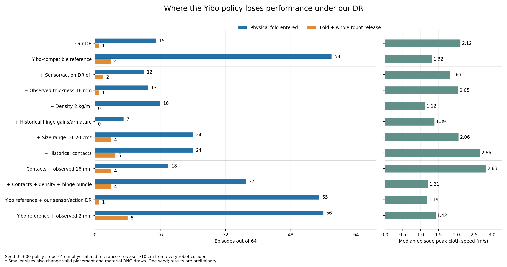

# Where the Yibo checkpoint breaks under our DR

In the controlled seed-0 matrix, our DR produced **15/64 physical folds**, versus **58/64** for the Yibo-compatible reference. Restoring the historical contact, density and hinge settings together raised our DR to **37/64**. No single restored factor closed the gap.

These are zero-shot results for the same checkpoint and five current rigid designs. Each case scores the first episode from 64 environments for at most 600 policy steps. The physical fold criterion is maximum corner error <4 cm and footprint <0.65; full success additionally requires every robot collider to clear the still-folded cloth by 10 cm. Actor keypoint goal errors are not used as the physical success measurement.

## Controlled results

| Change | Physical folds | Full fold + release | Falls | Median best error |
|---|---:|---:|---:|---:|
| Our DR | 15/64 | 1/64 | 10 | 10.60 cm |
| Yibo-compatible reference | 58/64 | 4/64 | 5 | 0.91 cm |
| + Sensor/action DR off | 12/64 | 2/64 | 4 | 11.25 cm |
| + Observed thickness 16 mm | 13/64 | 1/64 | 8 | 11.77 cm |
| + Density 2 kg/m² | 16/64 | 0/64 | 2 | 13.67 cm |
| + Historical hinge gains/armature | 7/64 | 0/64 | 9 | 15.33 cm |
| + Size range 10–20 cm* | 24/64 | 4/64 | 6 | 5.95 cm |
| + Historical contacts | 24/64 | 5/64 | 17 | 5.87 cm |
| + Contacts + observed 16 mm | 18/64 | 4/64 | 17 | 9.03 cm |
| + Contacts + density + hinge bundle | 37/64 | 4/64 | 9 | 2.07 cm |
| Yibo reference + our sensor/action DR | 55/64 | 1/64 | 5 | 1.14 cm |
| Yibo reference + observed 2 mm | 56/64 | 8/64 | 10 | 1.18 cm |

The first six “+” rows change one group on our DR. The next two restore combinations. The final two perturb the good Yibo reference, avoiding a misleading conclusion from changes on a poorly performing baseline.

### Breakdown by approximation

| Design | Our DR folds | Historical physics bundle folds | Yibo reference folds |
|---|---:|---:|---:|
| Single hinge | 1/13 | 9/13 | 12/13 |
| Strip 4 | 5/13 | 11/13 | 13/13 |
| Strip 8 | 3/13 | 3/13 | 11/13 |
| Hinge band | 4/13 | 9/13 | 12/13 |
| Flexible corners | 2/12 | 5/12 | 10/12 |

The gap is not restricted to one approximation, and the same historical physics bundle does not help every design equally. These small cohorts have different size/material realizations; they describe where episodes fail and do not establish a ranking of design fidelity or policy trainability.

## What the evidence says

- **Physics changes interact.** Density alone gives 16 folds, the historical hinge settings alone 7, and historical contacts alone 24; their joint restoration gives 37. This supports a compatibility problem involving the combination of contact, mass and hinge dynamics. It does not identify a unique pairwise interaction.
- **Added mass stabilizes motion without restoring the policy.** Fixing density at 2 kg/m² reduces the median episode peak cloth speed from 2.12 to 1.12 m/s and falls from 10 to 2, while folds remain essentially unchanged, 15 to 16. “Less violent” is not equivalent to “better folding.”
- **Historical contacts provide only a partial rescue and introduce more falls.** They raise folds from 15 to 24 and releases from 1 to 5, but falls rise from 10 to 17 and median peak speed from 2.12 to 2.66 m/s. The 4–10 mm rest shell is a compatibility proxy around 2 mm plates, not evidence of improved cloth fidelity.
- **The 16 mm actor thickness feature is not a sufficient explanation.** It gives 13 folds on our DR; adding it to historical contacts gives 18 rather than 24. On the version-matched good reference, changing only the observed feature to 2 mm gives 56 folds, versus 58 for its reference.
- **Delay/noise was checked in both directions.** Disabling the full sensor/action DR bundle gives 12 rather than 15 folds on our DR. Enabling it on the version-matched good reference gives 55 rather than 58 folds. These samples do not show delay/noise as the main folding-collapse mechanism; they do not establish that delay/noise is harmless. Release counts are too sparse for a strong separate attribution.
- **The smaller-size result is qualified.** The 10–20 cm range gives 24 folds and 4 releases, but dimensions also change yaw feasibility, placement bounds and the RNG draws before material sampling. Its initial material realizations differ, so this is a size/placement-procedure comparison, not a strict geometry-only intervention.

## Remaining release failure

The Yibo reference enters a fold in 58 episodes but releases successfully in only 4. Of the remaining episodes, 25 enter a fold and lose it, while 29 finish physically folded without satisfying the release condition. The source fine-tune terminated on folding; our task adds whole-robot withdrawal. Acquiring a fold and learning to leave it intact are separate requirements.

Release clearance uses conservative world-axis-aligned bounds for all robot colliders and cloth plates. Passing guarantees the requested separation, but these bounds can reject a pose whose actual meshes are already clear; the counts therefore describe the implemented detector, not an exact mesh-distance measurement.

## Controls, reproducibility and limits

- Initial robot joint positions/velocities, cloth points and dimensions match exactly for the sensor, observed-thickness, density, hinge and contact-only interventions. PhysX readbacks verify that density-only changes mass/inertia, hinge-only changes gains/armature, and contact-only preserves modern mass/gain draws. The same is checked in CPU regression tests; contact-only does not silently select the historical dispatcher that freezes modern material DR.
- After the shared-material allocation fix, the reference was rerun: Yibo 58/4 folds/releases before → 58/4 after; our DR 15/1 → 15/1. The same environments folded and released in both reruns, and their initial cloth points matched exactly. The final two inverse interventions are compared with the post-fix reference, not assumed identical across implementations.
- Older diagnostics reported 8/64 versus 60/64 because the policy loader reset the RNG to its saved seed 42 before the first reset. This runner explicitly reseeds to requested seed 0 after policy creation; every case in this matrix uses that protocol.
- One seed and 64 first episodes per case are preliminary evidence. Per-design and size/density cohort results are in `rigid_summary.json`; within-case cohorts are descriptive. Original Yibo training used seven other designs, a 1.5 cm fold tolerance and no new release objective, so this is not a native Yibo benchmark.

The results measure checkpoint compatibility, not which material values best represent real cloth. They do not justify changing the target DR to 2 kg/m², large numerical armature or inflated contact shells merely to recover the old checkpoint. The practical next step is to train/finetune under the target dynamics and withdrawal objective, with calibration of real material parameters kept separate from compatibility presets.

## Reproduce

Run `experiments/nov16_yibo_our_dr/evaluate_rigid.py --headless --device cuda:0 --case <case> --seed 0 --num_envs 64 --max_steps 600 --out <result.json>` using `.venv/isaacsim/bin/python`. `submit_rigid_eval.sh` runs the initial matrix on one scheduler-allocated GPU. Cases, readbacks, pre-reset motion/failure traces and full configs are saved under /share/portal/kk837/task_curriculum/debug_outputs/yibo_our_dr_analysis/rigid_local_2026-11-16.
