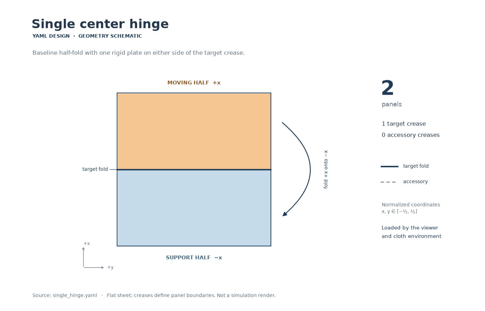
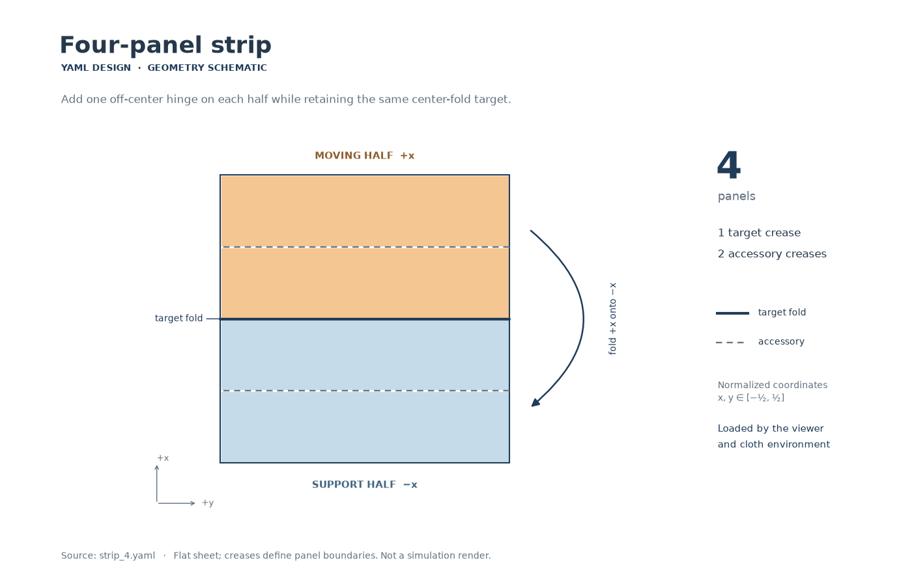
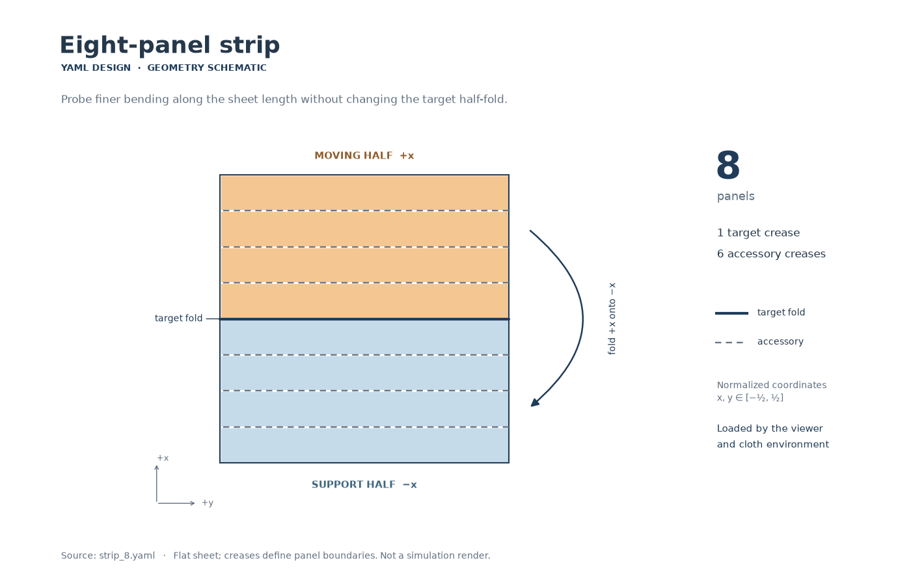
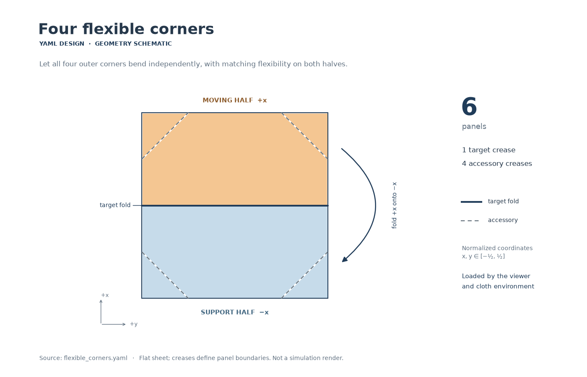
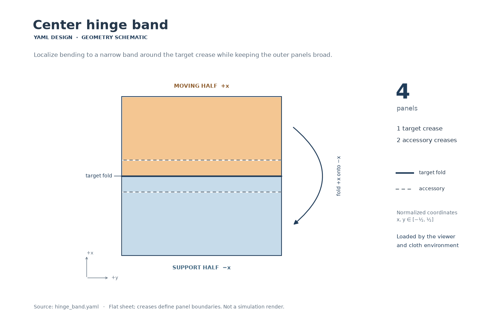

# Cloth design catalog

These YAML files define where a rectangular sheet is divided into rigid panels
joined by hinges. Both the simulator and the viewer load these files directly.
The loader derives panel polygons and hinge connections from the crease segments.

Every design has the same task: fold the moving **+x half onto the stationary
−x half**, about the center crease at `x = 0`. Additional hinges describe ways the
sheet can bend while attempting that fold. All five designs are mirror-symmetric
across both `x = 0` and `y = 0`. The failure modes below are intended probes, not
measured results.

| Design | Intended probe | Panels / hinges |
| --- | --- | --- |
| [Single center hinge](single_hinge.yaml) | Grasp retention, supporting-half motion, fold closure and release | 2 / 1 |
| [Four-panel strip](strip_4.yaml) | Local bending, support buckling, folds away from the center | 4 / 3 |
| [Eight-panel strip](strip_8.yaml) | Finer sag, multiple unwanted folds, distal-panel alignment | 8 / 7 |
| [Four flexible corners](flexible_corners.yaml) | Corner curl, tucked corners and local motion on either half | 6 / 5 |
| [Center hinge band](hinge_band.yaml) | A broad, displaced or incompletely closed fold | 4 / 3 |

## Use in simulation

The viewer discovers all YAMLs in this folder in its **Design YAML** dropdown.
Press **Apply geometry and restart** to switch designs or reload an edited YAML.

```sh
.venv/isaacsim/bin/python isaacsimenvs/scripts/visualization/viser_rigidCloth_viewer.py --design flexible_corners
```

For training, pass a list through the environment config:

```yaml
rigid_cloth:
  designs: [single_hinge.yaml, strip_4.yaml, strip_8.yaml, flexible_corners.yaml, hinge_band.yaml]
```

`ClothEnv` passes this list to `RigidBackend(cfg, design_paths)`. Filenames resolve
relative to this catalog; explicit paths also work. Designs are assigned cyclically
across environments. Each distinct design gets its own articulation group, so one
batch can contain different numbers of bodies and hinges. All groups return the
same observation layout in global environment order. Size assignment is independent
of design assignment.

## Coordinates and fields

The sheet occupies `x, y ∈ [-0.5, 0.5]`. Coordinates are normalized fractions of the
sheet length and width: physical positions are `(x × length, y × width)`. Each
named crease contains two endpoints. Corner creases can be diagonal; their physical
hinge axes account for the sheet's aspect ratio.

- `title` and `purpose` identify the approximation and what it probes.
- `failure_modes` lists behaviors to look for during manipulation.
- `shape: rectangle` identifies the outer boundary.
- `creases` defines the cuts that determine panels and their hinge connections.
- `image` names the matching PNG schematic.

Each crease must split one convex panel completely. The resulting hinge graph
must be a tree, with one complete center crease at `x = 0` for the half-fold task.
Crossing or incomplete cuts are rejected. The center crease is the designated fold
hinge; reset bends that hinge and leaves the others straight.

Physical dimensions, thickness, areal density, friction, stiffness and damping
belong to separate simulation settings. The loader supplies hinge limits, and the
environment can override the center hinge limits. Equal hinge parameters across
different panel counts do not imply equal overall bending stiffness.

## Schematics

### Single center hinge

[Definition](single_hinge.yaml) · [PNG](single_hinge.png)



### Four-panel strip

[Definition](strip_4.yaml) · [PNG](strip_4.png)



### Eight-panel strip

[Definition](strip_8.yaml) · [PNG](strip_8.png)



### Four flexible corners

[Definition](flexible_corners.yaml) · [PNG](flexible_corners.png)



### Center hinge band

[Definition](hinge_band.yaml) · [PNG](hinge_band.png)



## Regenerate images

The renderer reads these YAML definitions and regenerates the five PNG schematics and the overview:

```sh
.venv/isaaclab3/bin/python isaacsimenvs/scripts/visualization/rigid_cloth/render_designs.py
```
